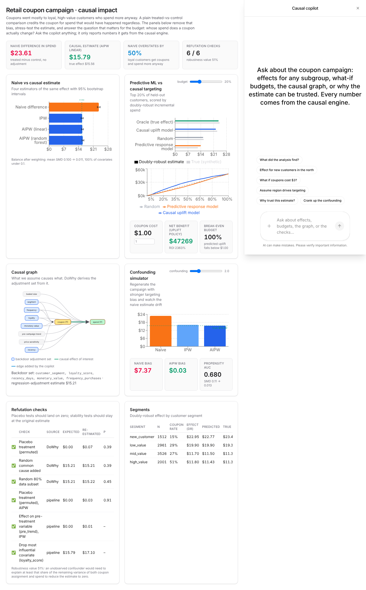

# Coupon Causal Impact Analysis

[](https://www.python.org/downloads/)
[](https://github.com/MysterionRise/retail-causal-impact/actions)
[](https://github.com/astral-sh/ruff)
[](https://codecov.io/gh/MysterionRise/retail-causal-impact)

Production-quality causal impact analysis for retail coupon campaigns. Estimate average and heterogeneous treatment effects (ATE, CATE), evaluate targeting policies, and optimize coupon allocation using state-of-the-art causal inference methods.

## 🎯 Features

- **Causal Estimation**
  - Average Treatment Effect (ATE): IPW, AIPW (doubly-robust)
  - Conditional ATE (CATE): DRLearner, Causal Forest (CausalForestDML), X-Learner
  - Propensity score modeling with diagnostics
  - Covariate balance assessment (Love plots, SMD)

- **Policy Learning & Uplift**
  - CATE models fit on a training split and evaluated on a held-out split
  - Doubly-robust policy evaluation (AIPW pseudo-outcomes), Qini curves, AUUC
  - **Predictive response model vs causal uplift model**: the same budget, scored by
    incremental spend, shows why "who will buy" is the wrong question
  - Budget-constrained targeting recommendations, segment-level uplift, ROI and net benefit

- **Robustness & Sensitivity**
  - Explicit causal graph; DoWhy derives the backdoor adjustment set from it
  - DoWhy refuters (placebo treatment, random common cause, data subset)
  - In-house checks on the headline AIPW estimate: permuted-treatment placebo,
    effect on a pre-treatment variable, leave-one-covariate-out
  - Cinelli & Hazlett robustness value for unobserved confounding
  - Bootstrap confidence intervals; synthetic data with known ground truth

- **Production-Ready**
  - Clean, modular Python package
  - CLI for end-to-end pipelines
  - Interactive Streamlit dashboard
  - Comprehensive test suite
  - Reproducible with fixed seeds and pinned dependencies

## 📋 Table of Contents

- [Installation](#installation)
- [Quick Start](#quick-start)
- [Usage](#usage)
  - [Command Line](#command-line)
  - [Jupyter Notebooks](#jupyter-notebooks)
  - [Streamlit Dashboard](#streamlit-dashboard)
- [Project Structure](#project-structure)
- [Methodology](#methodology)
- [Assumptions & Limitations](#assumptions--limitations)
- [Results](#results)
- [References](#references)

## 🚀 Installation

### Prerequisites

- Python 3.11, 3.12 or 3.13
- pip

### Setup

```bash
# Clone the repository
git clone <repo-url>
cd retail-causal-impact

# Install dependencies and setup
make setup

# Or manually:
pip install -e ".[dev]"
mkdir -p data/{raw,interim,processed} reports/{figures,tables} models
```

### Dependencies

Core libraries:
- **Causal inference**: `econml`, `dowhy`
- **ML/Stats**: `scikit-learn`, `statsmodels`, `numpy`, `pandas`
- **Visualization**: `matplotlib`, `seaborn`, `plotly`
- **Dashboard**: `streamlit`
- **Testing**: `pytest`, `pytest-cov`

See `pyproject.toml` for full dependency list with pinned versions.

## ⚡ Quick Start

### End-to-End Pipeline

Run the complete pipeline on synthetic data:

```bash
# Run the pipeline: data → estimation → refutation → reports (fast demo profile, ~2 min on 4 cores)
make all

# Or step-by-step:
make data        # Generate synthetic data
make train       # Run causal estimation
make report      # Generate plots and tables

# Heavier profile: 500 bootstrap draws, bigger forests, 5-fold cross-fitting (~15-25 min)
make full
```

Two config profiles are provided: `config/default.yaml` (fast, used by `make all`) and
`config/full.yaml` (thorough). Both run every estimator; they differ only in bootstrap
draws, model sizes and cross-fitting folds.

### Launch Dashboards

```bash
make app        # Streamlit, http://localhost:8501
make api        # causal engine API + copilot agent, http://localhost:8000
make web        # Next.js + CopilotKit dashboard, http://localhost:3000
```

### Run Tests

```bash
# Run all tests
make test

# Or with pytest directly
python -m pytest tests/ -v

# Run with coverage
python -m pytest tests/ --cov=src/coupon_causal --cov-report=term-missing

# Run specific test file
python -m pytest tests/test_synth_recovery.py -v
```

**Test Suite:**
- `test_synth_recovery.py` - Validates ATE/CATE recovery on synthetic data with known ground truth
- `test_balance.py` - Tests covariate balance improvement after propensity weighting
- `test_policy.py` - Tests policy learning, uplift evaluation (Qini, AUUC), doubly-robust
  policy value and the targeting-strategy comparison
- `test_refute.py` - Tests the causal graph, DoWhy identification/refuters, placebo checks,
  leave-one-out and the robustness value

29 tests, all passing on Python 3.11-3.13 with NumPy 2.4+.

## 📖 Usage

### Command Line

#### Generate and Analyze Synthetic Data

```bash
# Run pipeline on synthetic data (default)
python -m scripts.run_pipeline --config config/default.yaml --data_source synth

# Run specific stages
python -m scripts.run_pipeline --data_source synth --stage data
python -m scripts.run_pipeline --data_source synth --stage estimation
python -m scripts.run_pipeline --data_source synth --stage report
```

#### Analyze Public Dataset

```bash
# Place your dataset in data/raw/coupons.csv
# Required columns: treatment (0/1), outcome (continuous), features

python -m scripts.run_pipeline \
  --config config/default.yaml \
  --data_source public \
  --input data/raw/coupons.csv
```

#### Score and Deploy Targeting Policy

```bash
# Generate targeting recommendations
python -m scripts.score_policy \
  --scores reports/tables/cate_scores.parquet \
  --budget 0.2 \
  --cost_per_coupon 1.0 \
  --output reports/tables/targeting_recommendations.csv
```

### Jupyter Notebooks

Three step-by-step notebooks are provided:

1. **`notebooks/00_eda.ipynb`** - Exploratory Data Analysis
   - Treatment and outcome distributions
   - Covariate balance checks
   - Segment analysis

2. **`notebooks/10_causal_estimation.ipynb`** - Causal Estimation
   - Propensity score modeling
   - ATE estimation (naive, IPW, AIPW)
   - CATE estimation (DRLearner, Causal Forest, X-Learner)
   - Balance diagnostics

3. **`notebooks/20_policy_uplift.ipynb`** - Policy & Uplift
   - Qini curves and AUUC
   - Budget-constrained policy evaluation
   - Segment uplift analysis
   - Targeting recommendations

Run notebooks:

```bash
jupyter notebook notebooks/
```

### Streamlit Dashboard

Interactive dashboard for exploring results:

```bash
streamlit run app/streamlit_app.py
```

Tabs:
- **Overview**: data, treatment and outcome distributions
- **ATE: naive vs causal**: estimates with confidence intervals and the size of the bias
- **Assumptions & refutation**: the causal graph (rendered), DoWhy's backdoor set,
  propensity overlap, Love plot, refutation table, robustness value, leave-one-out
- **Uplift & policy**: CATE distribution, held-out Qini curve, budget slider
- **ML vs causal targeting**: predictive response model vs causal uplift model at the
  same budget, with doubly-robust (and true) incremental spend
- **Validation**: all CATE models on the held-out split, calibration by decile,
  predicted vs true effect
- **Segments**: predicted uplift by customer segment

## 🤖 Copilot (CopilotKit + AG-UI + Claude)

The Streamlit app is the quick look. The real product surface is a Next.js dashboard with a
CopilotKit sidebar whose agent answers questions by calling the causal engine as tools, so
every number it states is computed by the pipeline code, never by the model.



```
browser ── Next.js (web/) ── CopilotKit runtime ── AG-UI over HTTP ── FastAPI (services/api)
             dashboard panels + chat                                    ├─ Engine: subgroup effects, what-ifs,
             generative-UI cards for tool calls                         │  DAG edits + DoWhy re-identification,
             frontend tools (set budget, slider, focus panel)           │  confounding simulator, refutation
             shared dashboard state → agent context                     └─ Agent: Claude Opus 5.5 (streaming,
                                                                           tools, server-side refusal fallback)
```

What the copilot can do, each backed by a deterministic engine call:

| Ask | Tool | What you see |
|-----|------|--------------|
| "Effect for new customers in the north?" | `get_subgroup_effect` | doubly-robust effect with CI, naive gap, true effect |
| "What if coupons cost $3 at 15% budget?" | `whatif_budget` | net benefit, ROI, break-even budget; dashboard budget follows |
| "Assume region also drives who gets a coupon" | `edit_dag` | new backdoor set, re-estimated effect, graph redrawn |
| "Set confounding to 6" | `set_confounding_strength` (frontend) | simulator slider moves, naive drifts, AIPW holds |
| "Why trust this?" | `get_refutation` | six checks, robustness value |
| "Compare ML and causal targeting at 30%" | `compare_targeting` | per-strategy incremental spend, gain curves |

Run it:

```bash
make all                      # pipeline artifacts the engine loads (once)
export ANTHROPIC_API_KEY=...  # needed by the agent
make api                      # FastAPI on :8000  (REST under /api/*, AG-UI agent at /agent)
make web                      # Next.js on :3000  (first run: npm install)
# or everything in containers:
cp .env.example .env && docker compose up --build
```

The REST API is usable on its own (`/api/summary`, `/api/subgroup-effect`, `/api/whatif`,
`/api/dag/edit`, `/api/simulate`, ...; `/api/tools` lists the agent's tool definitions).
`services/api/tests` covers the engine, the AG-UI event stream with a fake Claude client,
and the HTTP surface.

## 📁 Project Structure

```
retail-causal-impact/
├── config/
│   ├── default.yaml          # Fast demo profile (seeds, hyperparameters, paths)
│   └── full.yaml             # Thorough profile (500 bootstrap draws, larger forests)
├── data/
│   ├── raw/                  # Place public datasets here
│   ├── interim/
│   └── processed/            # Generated/cleaned data
├── src/coupon_causal/        # Main Python package
│   ├── data.py               # Data loading & synthetic generation
│   ├── features.py           # Feature engineering
│   ├── propensity.py         # Propensity score models
│   ├── ate.py                # ATE estimation (IPW, AIPW)
│   ├── cate.py               # CATE estimation (DRLearner, Causal Forest, X-Learner)
│   ├── policy.py             # Policy learning, Qini, AUUC
│   ├── balance.py            # Balance diagnostics (SMD, Love plots)
│   ├── refute.py             # Causal graph, DoWhy refuters, placebo checks, robustness value
│   ├── viz.py                # Visualization utilities
│   └── utils.py              # Utilities (logging, config, seeds)
├── scripts/
│   ├── run_pipeline.py       # CLI orchestrator
│   └── score_policy.py       # Policy scoring CLI
├── notebooks/
│   ├── 00_eda.ipynb
│   ├── 10_causal_estimation.ipynb
│   └── 20_policy_uplift.ipynb
├── app/
│   └── streamlit_app.py      # Interactive Streamlit dashboard
├── services/api/             # FastAPI causal engine + AG-UI copilot agent (Claude)
│   ├── engine.py             # Queries over the pipeline artifacts (subgroups, what-ifs, DAG edits, simulator)
│   ├── tools.py              # Tool registry shared by the agent and the REST routes
│   ├── agent.py              # AG-UI protocol over a streaming Claude tool loop
│   └── main.py               # Routes: /api/* and POST /agent
├── web/                      # Next.js + CopilotKit (v2) dashboard and copilot
│   ├── app/api/copilotkit/   # CopilotKit runtime -> HttpAgent -> services/api
│   ├── components/           # Panels, charts, DAG view, generative-UI cards
│   └── lib/                  # API client, dashboard state
├── tests/
│   ├── test_synth_recovery.py  # ATE/CATE recovery on synthetic data
│   ├── test_balance.py         # Balance improvement tests
│   ├── test_policy.py          # Policy uplift, DR evaluation, targeting comparison
│   └── test_refute.py          # Causal graph, DoWhy, placebo and sensitivity checks
├── reports/
│   ├── figures/              # Generated plots
│   └── tables/               # Generated CSVs
├── models/                   # Saved models and results
├── Makefile                  # Build automation
├── pyproject.toml            # Dependencies & package config
├── LICENSE                   # MIT
└── README.md                 # This file
```

## 🧪 Methodology

### Data Generation (Synthetic Mode)

The synthetic data generator creates realistic confounded coupon campaign data:

1. **Customer Features**: Loyalty, recency, frequency, monetary value, price sensitivity, segments
2. **Confounded Treatment Assignment**: A propensity score p(X) rises with loyalty, recency,
   frequency and the high-value segment (companies target loyal customers). Treatment is
   *drawn* as T ~ Bernoulli(p(X)), so every customer has a non-zero chance of either arm
   and the positivity assumption holds. The logit intercept is calibrated to the target
   treatment rate.
3. **Heterogeneous Treatment Effects**: Effect varies by price sensitivity, loyalty and segment
   (new and low-value customers respond most; loyal customers least)
4. **Known Ground Truth**: True propensity, true CATE and true ATE are stored for validation

### Causal Estimation Pipeline

1. **Feature Engineering**
   - One-hot encoding for categorical variables
   - Standardization for continuous variables
   - Leakage prevention (drop post-treatment variables)

2. **Propensity Score Modeling**
   - Logistic regression and gradient boosting are both fit (out-of-fold predictions)
   - The model used for weighting and ATE is set by `propensity.ate_model`
     (default `logistic`, which is also what the bootstrap refits on every draw)
   - Calibration diagnostics, overlap assessment
   - Clipping to [0.01, 0.99] for stability

3. **ATE Estimation**
   - **Naive**: Simple difference in means (biased baseline)
   - **IPW**: Inverse propensity weighting with stabilization
   - **AIPW (Doubly-Robust)**: Combines outcome models + IPW
     - Linear and Random Forest outcome models
   - Percentile bootstrap 95% confidence intervals, refitting the propensity model on
     each draw (100 draws in the default profile, 500 in `config/full.yaml`)

4. **CATE Estimation**
   - **DRLearner** (EconML): Doubly-robust with cross-fitting
   - **Causal Forest** (EconML `CausalForestDML`): forest on orthogonalised residuals
   - **X-Learner**: Two-stage meta-learner with propensity weighting

5. **Balance Diagnostics**
   - Standardized Mean Difference (SMD) before/after weighting
   - Love plots (target: SMD < 0.1)
   - Variance ratios, positivity checks

6. **Held-out Policy Evaluation**
   - Stratified 70/30 split; CATE models are fit on the training split only
   - **Doubly-robust pseudo-outcomes** ψ on the test split (outcome models fit on
     train): the mean of ψ over any targeted group is an unbiased estimate of that
     group's incremental spend, so policies can be scored without the true CATE
   - **Qini Curve** / **AUUC** on the held-out split, plus a doubly-robust uplift curve
   - **Predictive vs causal targeting**: a gradient-boosted response model
     (E[spend | X, coupon]) and the causal uplift model each pick their top 20%;
     both are scored by ψ (and by the true effect on synthetic data)
   - Calibration by decile of predicted effect; budget-constrained ROI and net benefit;
     segment-level uplift

7. **Refutation and Sensitivity**
   - **Causal graph** (`refute.DEFAULT_CAUSAL_EDGES`): DoWhy derives the backdoor
     adjustment set and estimates by regression adjustment
   - **DoWhy refuters**: placebo treatment (expect ~0), random common cause and
     80% data subset (expect no change)
   - **In-house checks on the headline AIPW estimate**: permuted-treatment placebo,
     IPW effect on a pre-campaign variable (`pre_trend`), leave-one-covariate-out
   - **Robustness value** (Cinelli & Hazlett 2020): how strong an unobserved
     confounder would have to be to explain the effect away

   DoWhy's `propensity_score_weighting` estimator is deliberately not used for the
   refuters: on this data its placebo check returns about -9 where the truth is 0.

### Key Metrics

- **ATE**: Average increase in outcome (e.g., spend) due to treatment
- **CATE**: Customer-level predicted treatment effect
- **AUUC**: Policy performance metric (higher = better targeting)
- **SMD**: Covariate balance metric (target < 0.1)
- **ROI**: Return on investment for targeting policy

## ⚠️ Assumptions & Limitations

### Causal Assumptions

1. **SUTVA** (Stable Unit Treatment Value Assumption)
   - No interference between units
   - No hidden versions of treatment

2. **Ignorability** (Selection on Observables)
   - All confounders are observed and included in X
   - **Limitation**: Cannot account for unobserved confounders

3. **Positivity** (Common Support)
   - All units have some probability of receiving treatment/control
   - Checked via propensity score overlap diagnostics

### Practical Limitations

- **Unobserved Confounding**: If important confounders are missing, estimates may be biased
- **Model Misspecification**: CATE estimates depend on correct functional form
- **External Validity**: Results may not generalize to different populations/time periods
- **Stationarity**: Assumes treatment effect is stable over time

### Recommended Validation

1. **Synthetic Data**: Verify ATE/CATE recovery on known ground truth
2. **Placebo Tests**: Check for non-effects where none should exist
3. **Refutation**: Use DoWhy to test robustness
4. **A/B Test**: Deploy learned policy in experiment to validate uplift

## 📊 Results

### Synthetic Data Validation

All numbers below come from `make all` with `config/default.yaml` (10,000 customers,
seed 42) and are written to `reports/tables/`. The generator's realised true ATE for this
seed is **$15.56** (the `true_ate: 15.0` config value is the base effect before the
heterogeneity terms).

| Method | ATE Estimate | 95% CI | Error vs true |
|--------|--------------|--------|---------------|
| Naive | $23.61 | [$22.92, $24.25] | **+$8.05** (biased by confounding) |
| IPW | $15.71 | [$15.17, $16.22] | +$0.15 |
| AIPW (Linear) | $15.79 | [$15.40, $16.26] | +$0.23 |
| AIPW (RF) | $15.99 | [$15.68, $16.56] | +$0.43 |

- **Naive** overstates the effect by about 50% because loyal, high-spending customers
  are more likely to receive coupons.
- **IPW and AIPW** land within a few percent of the truth, and every interval contains it.
- **Balance**: mean standardised mean difference drops from 0.100 to 0.011 after
  weighting; the largest imbalance (high-value segment, 0.47) drops to 0.01, the largest
  remaining SMD is 0.04, and all 20 covariates are below the 0.1 threshold.
### Held-out CATE validation (3,000 customers the models never saw)

| Method | Corr. with true CATE | Incremental $ per customer, top 20% (doubly-robust) | Same, true effect |
|--------|---------------------|-----------------------------------------------------|-------------------|
| Causal Forest | 0.84 | $23.19 | $22.99 |
| DRLearner | 0.81 | $22.90 | $22.54 |
| X-Learner | 0.78 | $22.48 | $22.13 |

Calibration by decile of predicted effect: the Causal Forest's predictions run from
$10.1 (decile 1) to $23.4 (decile 10), the true effects from $9.6 to $23.8, and the
doubly-robust estimates track both within their confidence intervals.

### Predictive ML vs causal targeting (held-out, top 20% of customers)

| Targeting rule | Incremental $ per targeted customer (doubly-robust) | True |
|----------------|-----------------------------------------------------|------|
| Oracle (true CATE) | $24.49 | $24.27 |
| **Causal uplift model** (Causal Forest) | **$23.19** | **$22.99** |
| Random | $15.41 | $15.59 |
| Predictive response model (predict spend) | $13.83 | $12.46 |

The response model targets *worse than random*: it picks loyal, high-spending customers
who would have bought anyway. The doubly-robust scores reproduce the true values to
within about a dollar, which is what makes this comparison usable on real data where
the true effect is unknown.

### Refutation checks (headline AIPW estimate $15.79)

| Check | Source | Expected | Re-estimated | Result |
|-------|--------|----------|--------------|--------|
| Placebo treatment (permuted) | DoWhy | 0 | 0.07 (p = 0.40) | pass |
| Random common cause added | DoWhy | 15.21 | 15.21 (p = 0.39) | pass |
| Random 80% data subset | DoWhy | 15.21 | 15.22 (p = 0.45) | pass |
| Placebo treatment (permuted), AIPW | pipeline | 0 | 0.03 ± 0.23 | pass |
| Effect on pre-campaign trend, IPW | pipeline | 0 | 0.01 [-0.05, 0.08] | pass |
| Drop most influential covariate (loyalty) | pipeline | 15.79 | 17.10 (+8%) | pass |

DoWhy identifies `{loyalty_score, recency_days, frequency_purchases, monetary_value,
customer_segment}` as the backdoor set from the graph. The robustness value is 0.51:
an unobserved confounder would need to explain more than half of the remaining variance
of both coupon assignment and spend to reduce the estimate to zero.

### Example Output

```
AVERAGE TREATMENT EFFECT ESTIMATION
====================================
[1/4] Naive difference in means...
Bootstrap CI (95%) from 100 iterations: $23.61 [22.92, 24.25]
[2/4] Inverse Propensity Weighting (IPW)...
Bootstrap CI (95%) from 100 iterations: $15.71 [15.17, 16.22]
[3/4] AIPW with linear outcome models...
Bootstrap CI (95%) from 100 iterations: $15.79 [15.40, 16.26]
[4/4] AIPW with Random Forest outcome models...
Bootstrap CI (95%) from 100 iterations: $15.99 [15.68, 16.56]

CATE ESTIMATION
===============
DRLearner CATE     - mean: $15.88, std: $5.43
Causal Forest CATE - mean: $15.78, std: $5.01
X-Learner CATE     - mean: $16.08, std: $5.63

BALANCE DIAGNOSTICS
===================
Before weighting - Mean SMD: 0.100   (70% of covariates below 0.1)
After weighting  - Mean SMD: 0.011   (100% of covariates below 0.1)

HELD-OUT EVALUATION (train 7,000 / test 3,000)
==============================================
Mean DR pseudo-outcome on test set: $16.25
Using causal_forest for policy evaluation and targeting
Targeting strategies at 20% budget:
  oracle (true CATE)  dr_uplift_per_customer 24.49   true 24.27
  uplift_model        dr_uplift_per_customer 23.19   true 22.99
  random              dr_uplift_per_customer 15.41   true 15.59
  response_model      dr_uplift_per_customer 13.83   true 12.46

REFUTATION AND SENSITIVITY CHECKS
=================================
Backdoor adjustment set: ['frequency_purchases', 'customer_segment', 'monetary_value',
                          'recency_days', 'loyalty_score']
placebo effect 0.03 ± 0.23 (real estimate 15.79, p under placebo = 0)
PASSED: effect on pre-treatment outcome 0.01 [-0.05, 0.08]
Robustness value: a confounder would need partial R² ≥ 50.8% with both treatment
and outcome to explain the effect away
Refutation summary: 6/6 checks passed
```

## 🔗 References

### Causal Inference Methods

- **Doubly-Robust Estimation**: Robins, Rotnitzky, Zhao (1994)
- **Causal Forest**: Wager & Athey (2018), "Estimation and Inference of Heterogeneous Treatment Effects using Random Forests"; Athey, Tibshirani & Wager (2019), "Generalized Random Forests"
- **DRLearner**: Chernozhukov et al. (2018), "Double/debiased machine learning for treatment and structural parameters"
- **X-Learner**: Künzel et al. (2019), "Metalearners for estimating heterogeneous treatment effects"

### Uplift Modeling

- **Qini Curve**: Radcliffe (2007), "Using control groups to target on predicted lift"
- **AUUC**: Gutierrez & Gérardy (2017), "Causal Inference and Uplift Modelling: A Review of the Literature"

### Software

- **EconML**: Microsoft Research causal ML library - [github.com/microsoft/EconML](https://github.com/microsoft/EconML)
- **DoWhy**: Microsoft causal inference framework - [github.com/microsoft/dowhy](https://github.com/microsoft/dowhy)

## 🤝 Contributing

Contributions welcome! Please:

1. Fork the repository
2. Create a feature branch
3. Add tests for new functionality
4. Run `make test && make lint`
5. Submit a pull request

## 📝 License

MIT License - see [LICENSE](LICENSE)

## 📧 Contact

For questions or issues, please open a GitHub issue.

---

**Built with**: EconML, DoWhy, scikit-learn, Streamlit
